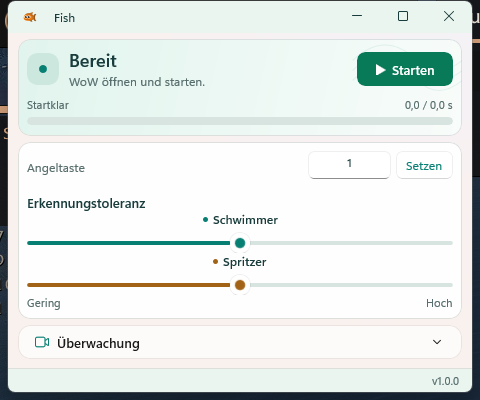

# Fish

Kompakter Angelbot für World of Warcraft unter Windows. Fish erkennt Schwimmer und Bisse anhand von Bildschirmaufnahmen und wirft automatisch erneut aus. Die Erkennung benötigt kein Addon und keine WeakAura.

**[Fish.exe herunterladen](https://github.com/leafcreek/Fish/releases/latest/download/Fish.exe)** · [Alle Releases](https://github.com/leafcreek/Fish/releases) · [Technische Dokumentation](docs/architecture.md)



## Loslegen

1. Die aktuelle **Fish.exe** aus den Releases herunterladen und starten. Die Laufzeiten für .NET und Windows App SDK sind enthalten; ein Installer ist nicht erforderlich.
2. WoW öffnen und das Spielfenster sichtbar lassen. Die veröffentlichte EXE ist für **Windows x64**; für die vollständige Darstellung wird Windows 11 empfohlen.
3. Die **Angeltaste** passend zur Spielbelegung einstellen. Standard ist `1`; über **Setzen** lassen sich auch Kombinationen wie `Strg+F8` aufnehmen. `Esc` bricht die Aufnahme ab.
4. Den Schwimmer-Suchbereich mit **✥** verschieben oder mit **◢** vergrößern. Er startet bei 600 × 300 Pixeln ohne Versatz. `Esc` verwirft eine laufende Änderung.
5. **Starten** drücken. Derselbe Button beendet die Sitzung über **Stoppen**.

Fish aktiviert WoW für Eingaben kurz und versucht danach den vorherigen Fensterfokus wiederherzustellen. Minimiertes WoW unterbricht die Erkennung. Beim Minimieren von Fish verschwinden auch die Suchrahmen.

## Bedienung

- **Status:** Zeigt den aktuellen Schritt und dessen Zeit. Ein Fund leuchtet kurz grün, ein abgelaufener Suchschritt rot.
- **Köder:** Bei aktivierter Option sendet Fish die Ködertaste (Standard `2`) vor dem Auswurf, wenn der Timer leer ist. Der normale Fortschrittsbalken zeigt die fünf Sekunden zum Anbringen. Danach läuft die Wirkzeit im zweiten Balken rückwärts, auch bei gestopptem Angeln. Der Button **5 min** oder **10 min** zeigt die gewählte Wirkzeit und schaltet sie per Klick um. Standardmäßig gelten zehn Minuten. **Makro** kopiert das WoW-Makro in die Zwischenablage. **▶** startet die gewählte Wirkzeit manuell, **■** stoppt sie. Beim Neustart von Fish beginnt die Restzeit leer.
- **Fensterleisten:** Die eigene Titelleiste zeigt das Goldfischsymbol und lässt sich zum Verschieben ziehen. Die schmale Statusleiste unten zeigt die Version des laufenden Builds.
- **Updates:** Ein Klick auf die Versionsnummer prüft GitHub auf eine neuere Version. Mit **Aktualisieren** wird sie heruntergeladen und geprüft; anschließend beendet Fish das Angeln, speichert die Einstellungen und startet neu. **Später** lässt alles weiterlaufen. Die Prüfung benötigt keine Anmeldung.
- **Erkennungstoleranz:** Zwei Regler für **Schwimmer** und **Biss**. Links ist die Erkennung strenger, rechts toleranter. Änderungen wirken direkt im laufenden Schritt. Wurf, Suchzeit, gefundener Schwimmer und Biss-Kalibrierung bleiben erhalten.
- **Überwachung:** Startet eingeklappt. Aufklappen zeigt Schwimmer und Biss nebeneinander sowie ein größeres Livebild darunter. Dabei ändert sich ausschließlich die Fensterhöhe. Breite und die beiden Zielhöhen bleiben fest, auch nach wiederholtem Umschalten.
- **Suchrahmen:** Petrol markiert den Schwimmerbereich, Gold den Bissbereich. Der Bissrahmen erscheint erst nach einem Fund, bleibt 50 × 50 Pixel groß und ist durchklickbar.

Das Fenster bleibt im Vordergrund und verwendet eine helle Oberfläche. Die kompakte Größe beträgt 480 × 480 Pixel bei 100 % Windows-Skalierung. Mit geöffneter Überwachung steigt die Höhe auf bis zu 820 Pixel, begrenzt durch die verfügbare Arbeitsfläche. Manuelles Vergrößern und Maximieren sind gesperrt.

## Erkennung und Ablauf

Nach dem Auswerfen wartet Fish zwei Sekunden auf das Aufsetzen des Schwimmers. Anschließend stehen volle fünf Sekunden für die Schwimmersuche zur Verfügung. Ein Fund wechselt zur Bisserkennung; ein Biss löst den Rechtsklick zum Einholen aus. Nach einer Sekunde Wartezeit beginnt der nächste Wurf. Ohne Fund oder Biss wird spätestens nach insgesamt 25 Sekunden neu ausgeworfen.

Die Schwimmersuche prüft mindestens zwei räumlich passende Merkmale aus blauer Feder, roter Feder, Körper und Metallöse. Treffer aus genau zwei Merkmalen benötigen drei aufeinanderfolgende Bestätigungen. Die Bisserkennung vergleicht aufeinanderfolgende Bilder und berücksichtigt normale Wasserbewegung. Eine höhere Toleranz kann zusätzliche Fehlertreffer zulassen.

Die Schwimmersuche trennt die Merkmale von der lokalen Wasserfarbe. Bei schwierigen Lichtverhältnissen gleicht sie Farbstiche aus und unterdrückt dünne Wellenreflexe, bevor Größe, Form und Anordnung bewertet werden. Das funktioniert ohne Gebietsprofile oder zusätzliche Einstellungen. Die Schwimmer-Toleranz erweitert dabei nur die Materialfarben im getrennten Vordergrund.

Das Farbprofil ist in die EXE eingebettet. Es wird kein zusätzliches Schwimmerbild benötigt. Die tatsächliche Erkennungsqualität und das erfolgreiche Einholen müssen im jeweiligen Zielclient beurteilt werden.

Details: [Angelablauf](docs/fishing-cycle.md) · [Schwimmerprofil](Assets/Detection/README.md) · [Bisserkennung](docs/splash-motion.md)

## Einstellungen

Fish speichert automatisch unter:

```text
%LOCALAPPDATA%\Fish\settings.json
```

Gespeichert werden Angeltaste, Köderoption, Ködertaste, gewählte Wirkzeit, beide Toleranzregler, Schwimmerbereich, Fensterposition und Formatversion. Die Köder-Restzeit lebt bis zum Schließen von Fish im Arbeitsspeicher. Feste Zeiten und Fenstermaße sind im Programm vorgegeben.

- Eine vorhandene `appsettings.json` neben der EXE wird einmalig übernommen, wenn am neuen Speicherort weder Hauptdatei noch Sicherung existiert. Die alten Dateien bleiben unverändert.
- Frühere individuelle Einzelwerte werden auf die nächstpassende heutige Reglerstellung übertragen. Bei den Standard-Basiswerten bleiben die Stellungen unverändert.
- Änderungen werden nach 400 ms Eingabepause und beim Schließen gespeichert. Die vorherige gültige Datei bleibt als `settings.json.bak` erhalten.
- Bei beschädigter Hauptdatei wird eine gültige Sicherung wiederhergestellt und das beschädigte Original separat aufgehoben. Neuere, nicht unterstützte Formate werden nicht überschrieben.
- Mehrere Fish-Kopien desselben Windows-Benutzers teilen standardmäßig ihre Einstellungen. Gleichzeitige Speicherzugriffe innerhalb einer Windows-Sitzung werden serialisiert; der zuletzt gespeicherte Stand gewinnt.

Für einen eigenen oder portablen Speicherordner:

```powershell
.\Fish.exe --settings-directory "D:\Fish-Portable"
```

Auch dort heißt die Datei `settings.json`. Eine alte `appsettings.json` wird in diesem Modus ausschließlich aus dem gewählten Ordner übernommen.

## Selbst bauen

Benötigt werden Windows und das **.NET 10 SDK**.

```powershell
dotnet restore Fish.csproj -r win-x64
dotnet run --project Tests/Fish.Tests.csproj -c Release
dotnet publish Fish.csproj -c Release -p:PublishProfile=win-x64
```

Die eigenständig lauffähige Einzeldatei entsteht unter `publish/Fish.exe`. Benutzereinstellungen gehören nicht in den Release-Download.

Releases verwenden übereinstimmende Versionen in `Fish.csproj` und GitHub-Tag (`v1.2.0`) sowie die Assets `Fish.exe` und `SHA256SUMS.txt`. Die Release Notes nennen die Änderungen kurz in Stichpunkten. Erst nach vollständigem Upload wird das Release veröffentlicht und als neuestes reguläres Release markiert. Eine veröffentlichte Version wird nicht nachträglich mit einem anderen Build überschrieben.

Beim Update bleibt die vorherige EXE als `<Name>.exe.bak` neben dem Programm erhalten. Kann die neue Version nicht starten, wird die Sicherung automatisch wiederhergestellt. Fehlen Schreibrechte, bietet Fish den manuellen Download an. Einstellungen bleiben an ihrem bisherigen Speicherort, auch mit `--settings-directory`. Temporäre Downloads liegen unter `%LOCALAPPDATA%\Fish\Updates`; über zwei Tage alte Aufträge werden beim nächsten Start aufgeräumt. Die SHA-256-Prüfung erkennt beschädigte Downloads; sie ist keine unabhängige Herausgebersignatur.

Gezielte Prüfung der Update-Logik:

```powershell
dotnet run --project Tests/Fish.Tests.csproj -c Release -- --updates-only
```

Für Änderungen an der Schwimmersuche genügen die gezielten Bildprüfungen einschließlich verschiedener Lichtfarben, Helligkeiten, Wasserfarben und Wellenphasen:

```powershell
dotnet run --project Tests/Fish.Tests.csproj -c Release -- --bobber-environments
```

Die Fensterprüfungen laufen separat am veröffentlichten Build:

```powershell
powershell.exe -NoProfile -ExecutionPolicy Bypass -File Tests/CompactUiSmoke.ps1 -Executable publish/Fish.exe
powershell.exe -NoProfile -ExecutionPolicy Bypass -File Tests/Smoke-Ui.ps1 -Executable publish/Fish.exe -NoSession -NativeOverlay
powershell.exe -NoProfile -ExecutionPolicy Bypass -File Tests/SessionUiSmoke.ps1 -Executable publish/Fish.exe
```

Die Tests verwenden eigene Fenster und isolierte Einstellungen. Der Sitzungstest verhindert Spieleingaben durch einen außerhalb von WoW liegenden Suchbereich. `DefaultSettingsUiSmoke.ps1` prüft ausdrücklich den echten Benutzerspeicher und dessen Migration; dieser Test gehört nicht zu den isolierten Standardprüfungen.

## Projekt

[Architektur](docs/architecture.md) · [Gestaltung](docs/design.md) · [Historische Dokumente](docs/archive/README.md)

- `Core/`: Erkennung, Angelablauf, Fortschritt und Vorschaupuffer.
- `Configuration/`: Benutzereinstellungen, Migration, feste Vorgaben und Toleranzkurven.
- `Native/`, `Services/`: Windows-Fenster, Bildschirmaufnahme, Eingaben und Suchrahmen.
- `Views/`, `ViewModels/`: Oberfläche und deren Zustand.
- `Assets/`: Goldfischsymbol und eingebettetes Farbprofil.
- `Tests/`: Simulationen, Bildregressionen und Fensterprüfungen.
- `publish/`, `artifacts/`: lokale Builds und Prüfergebnisse; nicht Teil des Repositorys.
